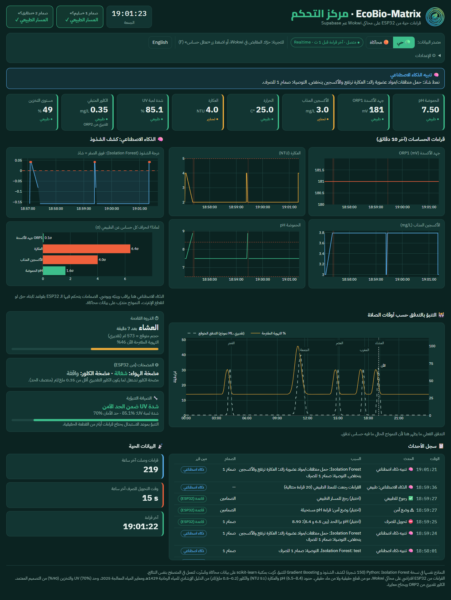
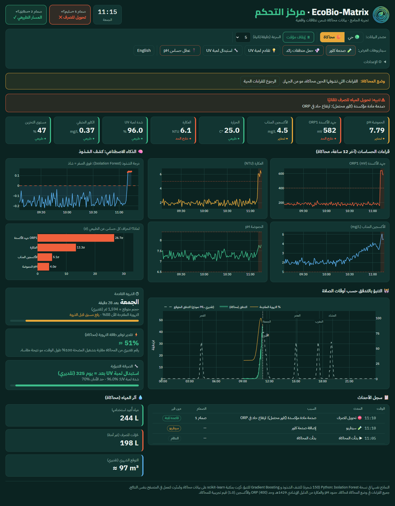

# EcoBio-Matrix · مركز التحكم

لوحة تحكم وحدة EcoBio-Matrix: وحدة مطمورة تحت الجامع تعالج ماء الوضوء، ونظام ذكي (حساسات + ESP32 + ذكاء اصطناعي) يراقب الماء ويحوّله للصرف تلقائيًا عند أي خطر.

**الرابط:** https://fahdadelalghamdi.github.io/Ecobio-dashboard/



> القراءات الحية تجي من ESP32 افتراضي على محاكي Wokwi، مو من قطع حقيقية ولا من ماء حقيقي. وكل رقم ما انقاس مكتوب جنبه «تقديري».

## وش في المستودع

| المجلد / الملف | وش فيه |
|---|---|
| `index.html` | **اللوحة نفسها** (ملف واحد)، وهي اللي يعرضها GitHub Pages |
| `dashboard-src/` | مصدر اللوحة: `template.html` والنماذج والشعار، و`build.py` اللي يبني `index.html`، واختبار المتصفح في `tests/` |
| `esp32-wokwi/` | برنامج الـ ESP32 (`sketch.ino`)، والتوصيلات (`diagram.json`)، والمكتبات، وخطوات التشغيل على Wokwi |
| `supabase/` | قاعدة البيانات: `schema.sql` للجداول والصلاحيات وRealtime، و`verify.sql` للفحص، والخطوات |
| `docs/` | صور اللوحة |

## كيف يشتغل النظام

```
ESP32 على Wokwi ──قراءة كل ثانية──► Supabase (sensor_readings, events) ──Realtime──► اللوحة
   │
   └── قواعد الحماية داخل الـ ESP32 نفسه: تشتغل حتى لو انقطع الإنترنت
```

- **الـ ESP32:**
  - يقرأ الحساسات وينفّذ قواعد الحماية السبع.
  - يحرّك الصمامين: صمام 1 «سليم؟» قبل المفاعل، وصمام 2 «مطابق؟» بعد الكلور.
  - يرسل كل قراءة وكل حدث لـ Supabase.
- **اللوحة:**
  - تعرض القراءات وحالة الصمامين والوضع الآمن مباشرة.
  - تعرض سجل الأحداث: الوقت، والسبب، والصمام، ومين قرر.
  - تشغّل نموذج **Isolation Forest** على القراءات الحية، وتنبّه وتوصي لما تشوف نمط غير طبيعي بين أكثر من حساس.
- **المفتاح العام** في الملفات (`sb_publishable_...`) مصمّم إنه يكون عام. صلاحيته إضافة وقراءة بس، وما يقدر يعدّل ولا يحذف (RLS في `supabase/schema.sql`).

## زر الاحتياط: حي / محاكاة

لو انقطع الإنترنت يوم العرض، اللوحة تنبّه، واضغط **«التبديل للمحاكاة»**. المحاكاة تشتغل بدون إنترنت، وفيها سيناريوهات: صدمة كلور، ومنظفات، وعطل حساس، وتقادم لمبة UV. ويظهر شريط برتقالي يوضح إنها محاكاة.

رابط المحاكاة مباشرة: https://fahdadelalghamdi.github.io/Ecobio-dashboard/?mode=sim



## تعديل اللوحة

1. عدّل `dashboard-src/template.html`.
2. شغّل الأمر:
   ```
   python dashboard-src/build.py
   ```
3. يتحدث `index.html`. ارفعه، والرابط يتحدث خلال دقيقة أو دقيقتين.

## حدود الأمان ومصادرها

| الحد | القيمة | المصدر |
|---|---|---|
| pH | 6.5–8.4 | الدليل الإرشادي للمياه الرمادية 1429هـ |
| العكارة | ≤ 5 NTU | معايير المياه المعالجة 2025 |
| الكلور المتبقي | 0.2–0.5 ملغ/لتر | دليل الوزارة |
| شدة UV | ≥ 70% | التصميم المعتمد |
| التخزين | ≤ 90% | التصميم المعتمد |

**تقديري:**
- **الكلور:** يتقدّر من ORP2 ويحتاج معايرة.
- **قفزة ORP1:** 150 mV.
- **نماذج الذكاء الاصطناعي:** متدرّبة على بيانات محاكاة.
- **التنبؤ بالتدفق وتقدير توفير الطاقة:** في وضع المحاكاة، ومو نتائج مقاسة.
